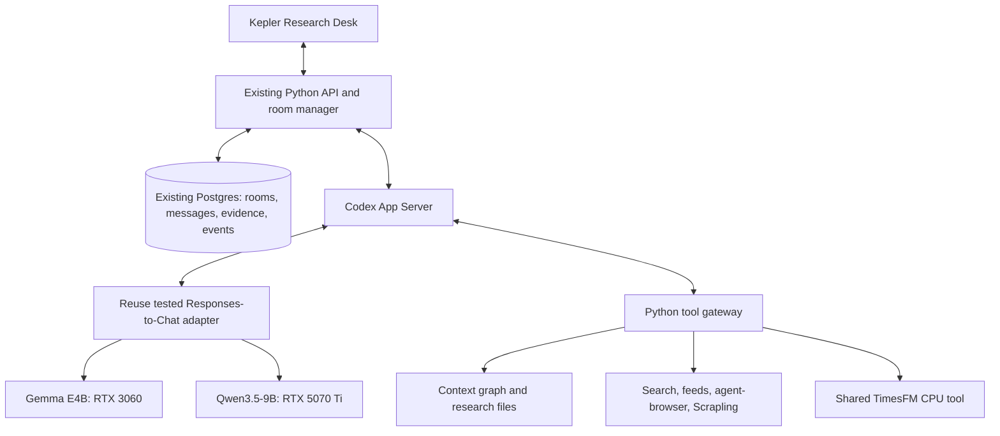

# Codex implementation for personal Kepler

Current work after `ae7d45f`: the first room and repair phase are delivered. Read [POST_TUNING_REVIEW.md](POST_TUNING_REVIEW.md), then [FRESH_SOURCE_IMPLEMENTATION.md](FRESH_SOURCE_IMPLEMENTATION.md) / [handoff](FRESH_SOURCE_HANDOFF.md). These supersede older current-handoff notices below. The selected runtime remains installed; inactive prompt candidates are evaluation history.

Current handoff after reviewing `aebd42d`: the first room is installed/activated. Follow [ROOM_REVIEW.md](ROOM_REVIEW.md), [NEXT_PHASE_IMPLEMENTATION.md](NEXT_PHASE_IMPLEMENTATION.md) and [NEXT_PHASE_HANDOFF.md](NEXT_PHASE_HANDOFF.md). They supersede old “build the first room” start instructions below. Codex remains selected; the graph test guard is implemented and must be retained.

The selected runtime is now active in the normal personal app at :8502. See [LOCAL_ACTIVATION.md](LOCAL_ACTIVATION.md) for activation and actual normal-path verification.

First usable room slice implemented locally on 1 November 2026 from `beaa5df`. See [RESEARCH_ROOM_IMPLEMENTATION.md](RESEARCH_ROOM_IMPLEMENTATION.md) for changes, native room results, failed grounding gates and preservation checks, and [RESEARCH_ROOM_RUNBOOK.md](RESEARCH_ROOM_RUNBOOK.md) for operation.

Decision updated 1 November 2026 after the user's clarification: **use Codex App Server with the tested local Responses-to-Chat adapter as Kepler's research-agent runtime.** This is the chosen implementation path, not an optional experiment or an undecided framework comparison. Kepler is the user's own trading/research workspace; build the useful local workflow without a separate commercial-product qualification process.

The browser and adapter-backed tool, streaming, cancellation, recovery and bounded-accounting fixtures in [FOLLOW_UP_FINDINGS.md](FOLLOW_UP_FINDINGS.md) provide enough evidence to make this engineering choice. They do not claim that every research answer is correct. Improve grounding as part of implementation. Keep manual approval for live entries, as already requested.

## Architecture to implement

One Python room manager owns scheduling, shared limits, persistence and cancellation. Codex handles each agent's reasoning/tool loop. Use separate top-level Codex threads for different roles and route them to the two tested local model services. Addressed messages pass through the room manager and are stored before being delivered to the recipient. This is the measured external-thread design; native heterogeneous child spawning is not required for this implementation.

Keep existing Python/ADK specialists where they provide useful data or deterministic calculations, exposed through tools. Replace the fixed sequential coordinator for the new research-room path. Do not build a second ADK room coordinator, add another agent framework, or reopen the Codex-versus-ADK selection. The existing workflow may remain available while the new path is being connected.

## Reuse the working configuration

- Start from the tested Codex version reported as 0.164, generated App Server schema and working adapter, with exact binary/source/config hashes recovered from the local F artifacts. Preserve the known working versions while integrating.
- Reuse the tested flat allowlisted dynamic functions. Keep native multi-agent, shell, goals and sleep features disabled initially. Use mediated browser and file/search tools rather than enabling a broad shell for research.
- Preserve the adapter's supported system/developer prefix handling, user/tool evidence roles, streamed events, stable IDs, call ownership/replay checks and terminal error states. It supports a specific text/function protocol subset; a complete Responses API implementation is unnecessary.
- Keep the measured llama.cpp/GGUF model services, including explicit CPU parameter placement. Use Gemma on the 3060 and Qwen on the 5070 Ti. Native start scripts or isolated environments are acceptable; Docker is optional. vLLM/SGLang are future alternatives when a concrete benefit warrants another trial.
- Start with one outstanding inference per model service. Multiple roles share those services; each role does not load another model. Keep the tested 32,768 context / 512 generated-token configuration for the first integration check, then measure changes needed for useful research responses.
- Run App Server, adapter and model endpoints locally. Give research tools the context and web access they need without account credentials or order authority. Preserve the existing broker loop.

## Practical implementation order

1. **Bring the tested code into the repository.** Local Codex locates the existing F adapter, runner/config and relevant fixtures, copies the reusable source into normal application-owned modules and records provenance/pins. Keep personal Codex homes, cookies, model weights and logs out of Git. Reuse rather than rewrite the adapter. Missing unrelated old logs do not block implementation; report missing source precisely if the working bridge itself cannot be found.
2. **Fix the known graph-test target issue before destructive graph tests.** Ordinary adapter, UI and fake-tool work can proceed independently. Preserve current data and services.
3. **Connect one useful research turn.** Open/resume a Codex thread, select the actual local model, load the pinned agent-browser skill, execute graph/file/web tools and return cited evidence through the existing API. Persist thread/turn/tool IDs and public messages. Display this real work in the dashboard.
4. **Connect an adaptive room.** Start with an evidence analyst and skeptic, plus a chair role when needed. Agents ask one another questions and retrieve missing context until they can conclude, preserve disagreement or abstain. No fixed speaking order or scripted conclusion. Bound repetition and terminate when the question is answered or limits are reached.
5. **Improve grounding during integration.** Inspect the existing 2/30 shared-register failures and scorer, use target-scoped evidence packets with relevant contradictions, validate cited IDs/facts, and retain explicit uncertainty. Follow [NEXT_VALIDATION_PLAN.md](NEXT_VALIDATION_PLAN.md) for a focused comparison. This is answer-quality work, not another vote on using Codex.
6. **Finish operational behavior for this PC.** Connect cancel/restart/reconnect, deduplicate tool actions and messages, and show model/service health. Verify the connected application paths; reuse completed component fixtures where unchanged. Account for two model services, browser, TimesFM and existing services within the measured host/GPU resources.
7. **Add the planned research capabilities.** Scheduled/event-driven rooms, GIFT/Singapore context, repaired news ingestion, Scrapling extraction and the optional office view follow the shared tools/events. Harness² can propose and evaluate prompt/retrieval improvements; the user still chooses which version becomes active.

## Limits and what “done” means

Use a single shared call/time/resource budget per room. The prior 327,680 reserved-token room count was conservative admission, not measured consumption. Record actual usage when exposed; otherwise keep reservations explicit and release them according to a documented completion/error policy. Adjust room ceilings to the real local context settings without silently dropping accounting.

The first usable version completes a real cited research task with two agents, shows their actual discussion and tool results live, handles cancellation/reconnect honestly, and leaves broker execution independent. Useful disagreement or “insufficient evidence” is a valid result. Model schema validity alone is not correct research.

TimesFM is an informational CPU tool while its cache/input defects are repaired; the measured historical sample did not demonstrate forecasting advantage or calibrated intervals. It does not set scores, position sizes, stops or targets. Autonomous research and manual approval of live entries remain the operating policy.

These are normal implementation and verification tasks for the user's own setup. Do not add a new generic production-readiness approval stage or require native Codex child routing before building the chosen design.
