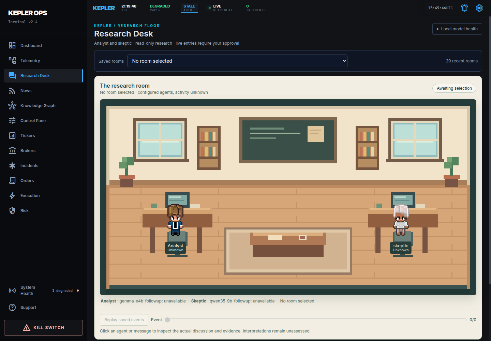

# Track C: visual research workspace

4 November 2026, Asia/Kolkata. Started from **`c4cedec`** on
`feat-generic-broker`; source **`3bd12d0`**. Fetch/fast-forward checks confirmed
the latest scope documents without disturbing the five local runtime files.

**Track C is implemented in this same phase.** Research Desk opens on a pixel-art
office with two character sprites, desks, monitors, bookshelves, plants and a
discussion table before any room is selected. Agent states, addressed bubbles
and click-through inspectors use the existing durable Kepler room events.
Source/market context and question controls are compact disclosures rather than
the main view. This delivers the office beyond the earlier form/transcript/cards.

**Tracks A/B are preserved.** No backend, protocol, snapshot, model, prompt or
serving configuration changed. [Original market findings](MARKET_CONTEXT_FINDINGS.md)
retain their provider gaps and failed/abstaining research results. The UI does not
repair those conversations or make their interpretations true. GIFT/STI quotes
remain honestly unavailable.



## Event projection and interaction

`research-office.ts` is a deterministic projection of one room's durable events.
It filters the selected room before deduplication, orders stable event IDs by
sequence and projects only records at/before the replay cursor. It exposes
queued, researching, tool, waiting, speaking, finished, failed, cancelled and
unknown states. Current model health is separate metadata; no selection means
**activity unknown**, not a claim that all agents are globally idle.

Actual `turn.started`, tool, publication and terminal events drive the state.
Manager budget records do not masquerade as agent work. A cancellation request
does not claim completion before the terminal event. Unknown activity, expired
leases and disconnected/stale latest views suppress working motion; terminal
records preserve the actual recorded outcome. An earlier replay position does
not inherit the current room's future terminal state or outcome. Latest total
counts are explicitly labeled as a separate current snapshot during replay.

Each bubble contains an actual published message with its addressed recipient.
Clicking a character opens that agent's discussion; clicking a bubble highlights
the exact matching event. Tools/evidence include the agent's tool results and
shared retrieved packets referenced by its claims. Source and market snapshots,
wrong-instrument citations, uncertainty and model-proposed support labels remain
visible. Duplicate display of identical message/claim text is suppressed; raw
citation metadata is available in a disclosure. No hidden reasoning is introduced.

Saved and streaming views use the same adapter. Replay has play/pause, next-event,
range selection and return-to-latest controls. It advances by **event sequence**
at a display pace, not original wall-clock duration, and says “Recorded replay ·
no new inference.” Recorded timestamps remain visible. Selection is retained in
local storage using the room ID only; reload restores the same saved room.
Older-room access, full transcript, cancel and explicit new-room controls remain.

Read requests have an eight-second deadline. Latest room synchronization older
than 12 seconds is stale; failures show cached-event/unknown-current-work text.
Terminal SSE delivery fetches durable history again rather than assuming the
last event repaired every possible delivery gap. Room-switch cleanup and replay
normalization were independently reviewed and corrected before final verification.

## Pinned reuse, sprites and rendering

Inspected Pixel Agents at **`b1bafd02896d90d83457266575a1e8e5011ce997`**.
Two 112×96 character sheets (`char_0`, `char_3`) were downloaded at that exact
revision and checked against Git blob IDs and SHA-256 hashes. Pixel Agents credits
JIK-A-4's [MetroCity characters](https://jik-a-4.itch.io/metrocity-free-topdown-character-pack);
the creator explicitly lists CC0 1.0. The repository's MIT notice and original
creator attribution accompany the sheets. A small MIT sprite-cache helper is
adapted; office/furniture and fallback characters are original Kepler pixel
geometry. No upstream furniture with unverified provenance was copied.

[Licenses and source inventory](../../third-party/pixel-agents/README.md)
record exact sources/hashes. No upstream agent hooks, terminal server, office
service, npm dependencies or alternate agent runtime were installed.

Canvas 2D uses one 960×500 coordinate system with unsmoothed pixel scaling and
matching native button hit areas. Connected observed research/tool work animates
at roughly six frames per second. Saved views, speaking-only states and unknown
activity do not run a continuous animation loop. Hidden/offscreen canvases and
reduced-motion preferences pause animation. Mobile retains the office image and
provides readable participant/message controls below it. Keyboard controls and
focus indicators remain available.

## Actual browser evidence

Actual isolated Chrome verified **http://localhost:8502** and the current LAN
**http://192.168.1.33:8502**. This address was re-read from the host; `.41` belongs
to the preceding phase's observations. Public screenshots and hashes are in the
[evidence manifest](evidence/visual-workspace-v1/manifest.json).

| Check | Observed result |
|---|---|
| No selection | Central office, both actual sprite sheets loaded with HTTP 200, configured model names and unknown scoped activity. Verified on both origins. |
| Saved market room | Original 125 events / 12 messages; finished avatars, real addressed message bubbles, abstention/message-limit result retained. |
| Agent/message inspector | Discussion and tools/evidence open; clicked message highlights its exact durable event; saved unavailable snapshots remain visible. |
| Replay/reload | Cursor zero shows no future messages/outcome; next event shows queued; selected room survives reload. No new room is created. |
| Mobile/access | 390-pixel viewport has 390-pixel document width; native participant controls, keyboard focus and reduced motion exercised. |
| Actual API outage | Stopped only the research API. Cached discussion stayed visible with 503/stale/unknown-current-work text; no false working animation. Restoring the API recovered the same saved discussion. |
| Offline connected trace | Explicitly labeled **synthetic fixture**, intercepted in Chrome only: queued → researching → tool → speaking → cancelled. Fictional cancel POST was intercepted; real POSTs were blocked. No real room/model operation. |

Screenshots: [saved](evidence/visual-workspace-v1/saved.png),
[agent inspector](evidence/visual-workspace-v1/inspector.png),
[replay](evidence/visual-workspace-v1/replay.png),
[mobile](evidence/visual-workspace-v1/mobile.png),
[actual outage](evidence/visual-workspace-v1/error.png),
[recovered](evidence/visual-workspace-v1/reconnected.png),
[labeled tool fixture](evidence/visual-workspace-v1/offline-fixture-tool.png),
[labeled speaking fixture](evidence/visual-workspace-v1/offline-fixture-speaking.png),
[labeled cancellation](evidence/visual-workspace-v1/offline-fixture-cancelled.png).

The fixture returned a terminal cancelled record, closed the stream and retained
cancelled state after reload, without touching the real closed market run. This
is a controlled browser trace, **not a fresh live-inference success**. The actual
A/B active-inference cancellation is retained from its original measured run.
No JavaScript or unexpected research HTTP error occurred in normal views;
favicon 404 remains. Expected outage 503s are recorded separately.

One five-second static Chrome sample measured **0 animation-frame callbacks**,
0.093 seconds of TaskDuration, and JS heap 22.7→37.6 MB. This is a development
sample, not a memory-leak or long-run performance assessment. The single-hook
connected fixture measured **29 callbacks / five seconds** (about 5.8/s);
offscreen, reduced-motion and cancelled checks each measured **0 / three seconds**.
The offscreen test used a temporary fixture-only spacer and verified the canvas
was outside the viewport. An earlier invalid scroll attempt and a doubled hook
were corrected before reporting these final samples. Models were stopped during
UI measurements; this does not establish simultaneous inference performance.

## Checks, budget and preservation

- **35 frontend tests passed**, TypeScript passed, and Vite built to a private
  output directory. The existing KnowledgeScreen chunk warning remains. A test
  mock initially needed its `Promise<Response>` annotation before final typecheck.
- **82 focused protected backend tests passed**, zero skipped/failed. These cover
  retained terminal/cutoff/undated handling, market snapshots, API and Unix proxy.
  Existing websockets deprecation warnings remain. No unsafe/operator-graph
  deletion fixture or destructive graph integration directory was run.
- Source diff contains no A/B backend change. All three original room payload/event
  hashes, statuses and counters match the private before snapshot after UI work
  and API restart. Source table counts remain **71 / 71 / 6**, market rows **3**.
  Four protected operator-control hashes match before; manual approval/configuration
  and broker services were not changed.
- All five local runtime files match their bytes at this task's start. They remain
  uncommitted; private before copies and stash **`b69b0eb` / `stash@{0}`** remain.
  No reset, clean, forced switch, ignored-file overwrite or stash deletion occurred.

UI evidence ID **`visual-workspace-20261104T153719Z`** records **zero new model
admissions, zero model-tool admissions and zero market-provider requests**. Asset
inspection/downloads and local browser HTTP reads are separate UI traffic.
No inference run was registered or renewed. Combined phase remains **41 model /
39 tool** within the original 60/60 ceiling, with original reserved **1,343,488**,
reported input **458,776**, output **5,142** and **two unknown-usage calls**.
Those old usage totals are unchanged, not new UI consumption.

Research API/models/worker were found stopped. Only the research API was started
for saved history and later restarted for the outage test. Models and research
worker remain stopped as found; their current unavailable health is displayed.
Use the existing `make research-start` workflow when actual new research is wanted.
The normal broker/API/database/graph/dashboard containers were preserved.

Raw DOM, browser drivers, profile-free screenshots and audit logs are private at
`~/.local/state/kepler-rooms/visual-workspace-20261104T153719Z/`. Selected screenshots,
fixture labels, licenses, hashes and non-secret checks are published under
`evidence/visual-workspace-v1/`; no credentials/private runtime contents are exported.

## Remaining limits and handback

Track C changes observation/interaction, not research accuracy or quote access.
The source-summary failure, wrong-instrument market citations, repetition,
unqualified GIFT/STI feeds and current GIFT session uncertainty remain exactly as
reported in A/B findings. Room sequence replay is a scoped record, not a global
workload monitor or original-time reenactment. Accessibility and performance
checks are focused samples, not exhaustive audits or soak tests.

Review this combined A/B/C delivery before the documented next work:
TimesFM/advisory integration, then broader research scheduling and Harness².
None was started here, and no additional budget is implicitly granted.

```text
KEPLER MARKET-CONTEXT FINDINGS
Starting / source / evidence commits and branch: c4cedec -> Track C source3bd12d0; evidence commit follows in history; feat-generic-broker. A/B30b5c39/e70a3b0 retained.
I1 terminal-stream correction and actual rejection/dispatch tests: A/B correction unchanged; focused loopback regressions pass, no protocol edits.
I2 earlier-cutoff/reversion preservation: A/B minimum cutoff/frozen/reversion behavior preserved and regression-tested.
I3 undated omissions/continuation: A/B cap/later-page/lower-bound disclosures preserved and regression-tested.
GIFT instrument/contract + provider and quote/history/socket capability: Original expired-auth/unresolved-contract qualification remains; no new provider study.
Singapore exact index/proxy + provider/delay capability: Original STI cash target and unavailable licensed quote/delay retained; no proxy substitution.
Calendar/session/timezone/holiday/reference sources and versions: Existing source versions/unknowns retained; no new price, delay, overnight business-date or reference inference.
Real snapshot statuses, timestamps/units/delay/basis and unavailable gaps: Same3 unavailable snapshots, identities/timestamps and cutoff metadata displayed through inspectors.
Snapshot storage/as-of availability and data preservation: No backend/storage changes; source71/71/6 and market3, original event hashes/counters unchanged.
Required Pixel workspace delivered (sprites/office, real states/bubbles, click-through): Central pixel office before selection, pinned licensed character sprites, actual event states/addressed text and agent/message discussion/tool/evidence inspectors.
Office no-selection/live/saved/error/reconnect screenshots and interaction checks: Actual localhost/LAN screenshots; connected/cancel trace explicitly synthetic and intercepted, no inference; replay/mobile/keyboard/reduced-motion verified.
Tool/market cards/collector behavior delivered: A/B preserved; context/control panels collapsible, saved snapshots attached to original records; collector unchanged.
Offline/disposable/frontend checks passed/skipped/failed:35frontend+types/build passed;82protectedbackend passed/0skips/0failures. Existing bundle/deprecation warnings.
Live source-summary/context rooms, actual useful facts and uncertainty: Original two12-message abstentions replayed unchanged, failures and wrong citations visible; no claim of repaired reasoning.
New run ID and model/tool/provider counts, actual/reserved/unknown usage: UI evidence visual-workspace-20261104T153719Z;0/0/0 new; phase41model/39tool unchanged,1343488reserved,458776input/5142output reported,2unknown; original market run stays closed.
LAN/localhost cancellation/reload/API-restart evidence: Actual :8502 on localhost and .33; persisted selection, cached503/recovery, unchanged saved hashes. Fixture cancel closes stream and survives reload.
Broker/control/manual-approval and runtime-file preservation: Four protected controls/configuration unchanged;5runtime files byte-preserved and uncommitted; stashb69b0eb retained. Only research API started; models/worker remain stopped as found.
Sanitized artifacts pushed / private evidence locations: findings + evidence/visual-workspace-v1; private ~/.local/state/kepler-rooms/visual-workspace-20261104T153719Z/; pinned licenses in docs/third-party/pixel-agents.
Remaining data/model limits and next task: Existing entitlement/calendar/grounding gaps remain; review A/B/C, then documented TimesFM/advisory scope. No new inference authorization or later implementation assumed.
```
